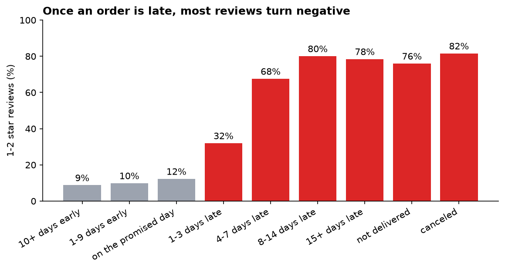
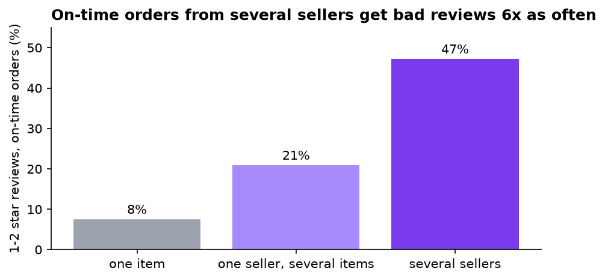
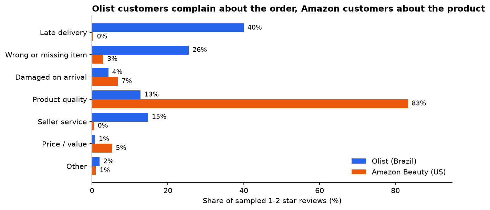

# Why do online shoppers leave 1-2 star reviews?

An analysis of about 100,000 orders from [Olist](https://www.kaggle.com/datasets/olistbr/brazilian-ecommerce), a Brazilian marketplace, compared with Amazon Beauty reviews from the same years (2016-2018). SQL in DuckDB for the order data, an LLM (Gemini) for the review text, and a check of the LLM against hand labels and real delivery records.

**[Read the full analysis →](notebooks/analysis.ipynb)** · Dashboard: `streamlit run app.py`

## Findings

**1. Late or missing orders are 8% of Olist's reviews but 36% of its bad ones.** On-time orders average 4.29 stars, late orders 2.27. Arriving early earns no extra credit; the drop starts on the first day late.



**2. Orders split across sellers look incomplete.** Even when delivered on time, orders from several sellers get 1-2 stars 47% of the time, against 7.5% for one-item orders. In the labeled sample, 86% of those complaints are about a "missing" item. Each seller ships separately, so the review request can reach a customer holding only part of the order.



**3. The two marketplaces fail differently.** 80% of Olist's bad reviews are about getting the order (late delivery, wrong or missing items, seller service). 83% of Amazon Beauty's are about the product itself.



**4. The LLM labels hold up where it matters.** Gemini and a hand labeler (me) chose the same category for 65% of 91 reviews (Cohen's kappa 0.51). In a blind second look at the 32 disagreements, Gemini's label fit the definitions better in 21, so against the reviewed labels it was right on 88%. Category totals matched within a few reviews, and 72% of its "late delivery" labels were confirmed by Olist's delivery dates. Its one systematic error: calling products that broke after use "damaged on arrival".

## How it works

1. **Load** (`src/load_data.py`): Olist's 7 CSVs and the Amazon Beauty JSONL go into one DuckDB file. Amazon is filtered to 2016-2018 and deduplicated.
2. **Model** (`sql/01_views.sql`): one row per order with its delivery outcome, one row per review, and a fixed random sample of 400 1-2 star reviews per marketplace.
3. **Analyze** (`sql/02`-`10`): delivery timing vs ratings, regions, categories and order types.
4. **Label** (`src/label_reviews.py`): Gemini sorts each sampled review into one of 7 complaint categories (`src/taxonomy.py`), using structured JSON output limited to those categories. Batches of 25 kept the whole run inside the free tier.
5. **Check** (`src/hand_label.py`, `src/review_disagreements.py`, `src/evaluate.py`): reviews labeled by hand without seeing the model's answers, a blind second look at every disagreement, and Olist's delivery dates as an independent check.
6. **Present**: a [notebook](notebooks/analysis.ipynb) with the full analysis, and a Streamlit dashboard (`app.py`) with a review browser.

## Run it

```bash
python -m venv .venv
.venv\Scripts\activate          # macOS/Linux: source .venv/bin/activate
pip install -r requirements.txt
```

1. Download the [Olist dataset](https://www.kaggle.com/datasets/olistbr/brazilian-ecommerce) into `data/raw/olist/`, and [`All_Beauty.jsonl`](https://huggingface.co/datasets/McAuley-Lab/Amazon-Reviews-2023/blob/main/raw/review_categories/All_Beauty.jsonl) into `data/raw/amazon/`.
2. Copy `.env.example` to `.env` and add a free [Gemini API key](https://aistudio.google.com/apikey).
3. Run:

```bash
python src/load_data.py
python src/label_reviews.py
python src/hand_label.py        # optional: your own labels
python src/evaluate.py
streamlit run app.py
```

The labels used in the analysis are already in `data/labels/`. You only need a Gemini key to redo them.

## Limitations

- Olist and Amazon Beauty differ in more than logistics (country, product range, review habits), so the comparison is directional.
- One person made the hand labels and the blind review. For Portuguese reviews, they relied on Gemini's own translation.
- The rating gaps are correlations: late orders also differ by region and product size.
- 400 reviews per marketplace gives roughly ±5 percentage points on each share; the several-seller group has only 21 labeled reviews.

## Data

- Olist: [Brazilian E-Commerce Public Dataset by Olist](https://www.kaggle.com/datasets/olistbr/brazilian-ecommerce), CC BY-NC-SA 4.0.
- Amazon: [Amazon Reviews 2023](https://amazon-reviews-2023.github.io/), McAuley Lab, UC San Diego (Hou et al., 2024, *Bridging Language and Items for Retrieval and Recommendation*).

Raw data isn't included in this repository.

---

Saba Khvichia · [LinkedIn](https://www.linkedin.com/in/saba-khvichia-125834331)
